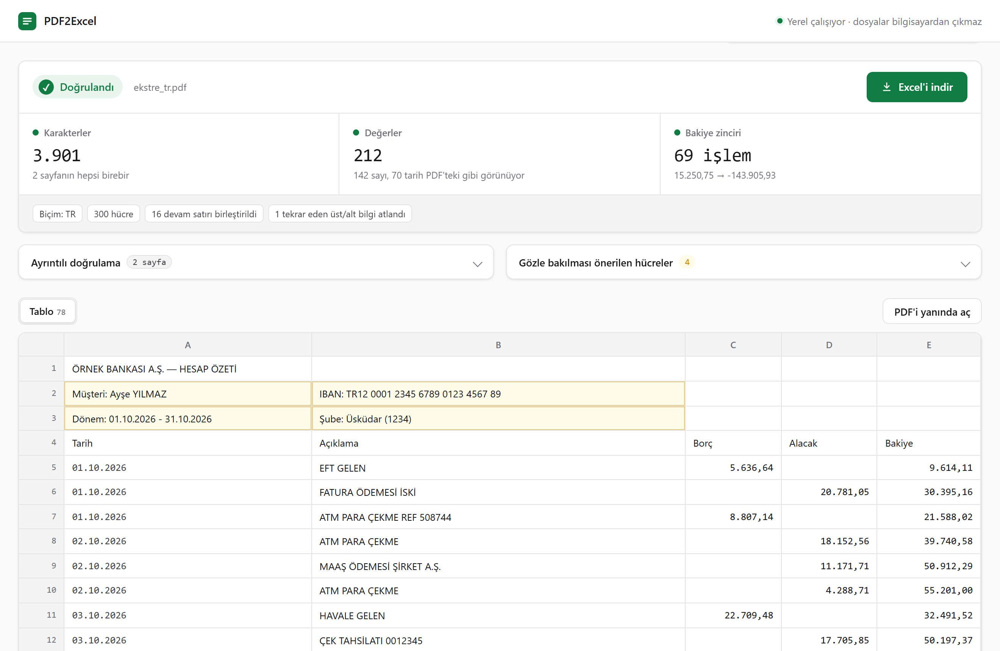

# PDF2Excel

PDF'teki tabloları Excel'e çeviren ve **yazdığı Excel dosyasını PDF'e karşı doğrulayan** ücretsiz Windows uygulaması. Her şey bilgisayarınızda çalışır; dosyalarınız hiçbir yere gönderilmez.

**[İndir (Windows 10/11)](https://pdf2excel-ten.vercel.app/PDF2Excel.exe)** · [Web sitesi](https://pdf2excel-ten.vercel.app)



## Kullanım

1. `PDF2Excel.exe`'ye çift tıklayın (kurulum gerekmez).
2. PDF'i pencereye sürükleyin.
3. Doğrulama sonucuna bakın, "Excel'i indir" ile kaydedin.

İlk açılışta Windows SmartScreen uyarı verebilir (uygulama imzalı değil): **Ek bilgi → Yine de çalıştır**.

## Doğrulama

Her dönüşümden sonra Excel dosyası yeniden açılır ve kontrol edilir:

1. **Karakterler:** Her sayfadaki tüm karakterler (boşluk hariç) Excel'de birebir ve aynı sayıda var mı?
2. **Değerler:** Sayıya veya tarihe çevrilen her hücre, Excel'de PDF'teki metnin aynısı olarak mı görünüyor? Görünmüyorsa hücre çevrilmez, metin kalır (`00123`, 16 haneli kart numarası, `=...` gibi).
3. **Bakiye zinciri:** Tabloda Bakiye ile Tutar ya da Borç/Alacak sütunları varsa her satırda `önceki bakiye + tutar = bakiye` kontrol edilir. Bu, satırların eksiksiz ve doğru sırada olduğunu kanıtlar.

Yerleşim (bir metnin hangi sütuna ait olduğu) hizalardan çıkarılır; emin olunamayan hücreler işaretlenir ve PDF sayfası yanında açılıp karşılaştırılabilir.

Ayrıca: çizgili tablolardaki birleşik hücreler, birkaç satıra yayılan açıklamalar, sayfa sonunda bölünen satırlar, her sayfada tekrar eden üst/alt bilgiler, kalın görünsün diye üst üste basılmış karakterler ve eski fontlardaki `ý þ ð` hatası ele alınır. `1.234,56` ve `1,234.56` biçimleri otomatik tanınır.

## Sınırlar

- Taranmış/fotoğraf PDF'lerde metin katmanı yoktur; OCR henüz yok.
- PDF'in kendi metin katmanı bozuksa doğrulama bunu göremez, çünkü karşılaştırma o katmanla yapılır.
- Şimdilik yalnız Windows (masaüstü uygulaması). Kaynaktan çalıştırınca tarayıcı arayüzü her sistemde çalışır.

## Geliştirme

```bash
py -3 -m venv .venv
.venv\Scripts\python.exe -m pip install -r requirements.txt
```

- Tarayıcı arayüzü: `.venv\Scripts\python.exe app.py` → http://127.0.0.1:5050
- Masaüstü penceresi: `.venv\Scripts\python.exe desktop.py`
- Komut satırı: `.venv\Scripts\python.exe -m pdf2excel dosya.pdf` (ya da bir klasör; `--sayfa`, `--tr`, `--en`)
- Testler: `.venv\Scripts\python.exe -m tests.test_accuracy` (örnek PDF'leri üretir, sonucu bilinen doğru tabloyla hücre hücre karşılaştırır)
- `.exe` derleme: `.venv\Scripts\python.exe build.py` → `dist\PDF2Excel.exe`

Yapı: `pdf2excel/engine.py` (tablo çıkarma), `values.py` (sayı/tarih), `output.py` (Excel yazma + doğrulama), `checks.py` (bakiye zinciri), `app.py` (Flask arayüzü), `desktop.py` (pencere), `docs/` (web sitesi).

## Lisans

MIT
